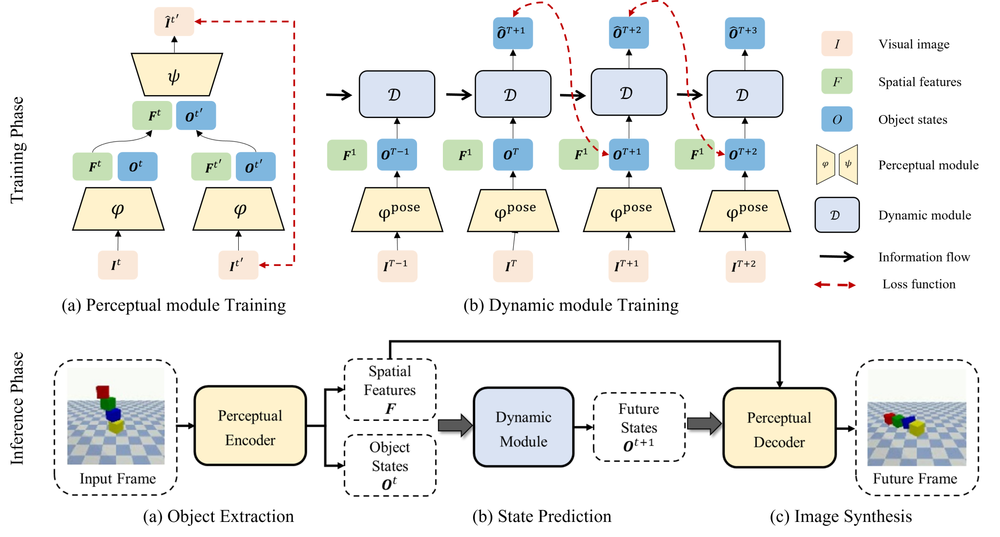
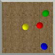
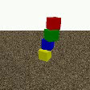
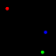

# Learning Visual Dynamics via Unsupervised Object-centric Prediction

## 💡 Introduction

This repository provides the PyTorch implementation for learning object-centric representations and predicting visual dynamics from videos.

Training consists of two stages: learning to represent objects and reconstruct images, then learning their dynamics. The dynamics model combines object states, spatial context, and motion history to predict future states, which can be decoded into video frames or evaluated as trajectories.



**Method overview.** The perceptual module extracts object representations without object-level annotations. The dynamics module predicts future object states using spatial context and motion history, and the decoder reconstructs future frames.

## 📑 Contents

- [Installation](#installation)
- [Dataset preparation](#datasets)
- [Training](#training)
- [Evaluation and checkpoints](#evaluation)
- [Repository layout](#layout)
- [License](#license)

<a id="installation"></a>

## 🛠️ Installation

```bash
git clone https://github.com/return-sleep/object-centric-visual-dynamics.git
cd object-centric-visual-dynamics

conda env create -f environment.yml
conda activate ocvd
```

The supplied environment specifies Python 3.7, PyTorch 1.11, torchvision 0.12, and CUDA 11.3. Python dependencies are listed in `requirements.txt`.

<a id="datasets"></a>

## 📦 Dataset preparation

Example frames from the four datasets:

| Balls | Blocktower | SimB | OBJ3D |
|:---:|:---:|:---:|:---:|
|  |  |  |  |
| Ball interactions | Block dynamics | Object trajectories | 3D object scenes |

These are dataset frames, not model predictions. Dataset sources and preparation instructions are listed in the [dataset guide](docs/DATASETS.md).

The following configurations are included:

| Dataset | Task | Conditioning frames | Prediction frames |
|---|---|---:|---:|
| Balls | Video prediction | 3 | 25 |
| Blocktower | Video prediction | 1 | 25 |
| SimB | Trajectory prediction | 4 | 20 |
| OBJ3D | Video prediction | 6 | 14 for training; 44 for evaluation |

Use `ballsCF`, `blocktowerCF`, `simb`, or `obj3d` as the dataset name in commands. For example, register the Balls dataset by replacing the path below with your local data directory:

```bash
python tools/prepare_dataset.py --dataset ballsCF --source /path/to/CoPhy_112
```

<a id="training"></a>

## 🚀 Training

To train the perception and dynamics models on Balls and evaluate the resulting checkpoint, run:

```bash
python tools/run.py --dataset ballsCF --mode reproduce --gpu 0
```

To inspect the commands before starting a run, add `--dry-run`. This prints the commands without executing them.

Dataset-specific training arguments are stored in `configs/`. The default seed is 1024; training outputs are written under `runs/<dataset>/`.

<a id="evaluation"></a>

## 🧪 Evaluation and checkpoints

To evaluate a pretrained model, place its perception and dynamics checkpoints in the directories described in the [checkpoint guide](checkpoints/README.md). Download links will be added when the weights are uploaded to GitHub Releases.

For example, evaluate Balls with:

```bash
python tools/run.py --dataset ballsCF --mode eval --gpu 0
```

For Balls and Blocktower, evaluation saves `metric_table.csv` and `log.json` beside the dynamics checkpoint. Both datasets have been evaluated on all 188 supplied test videos; measured results and verification details are available in [evaluation results](docs/RESULTS.md).

OBJ3D uses a separate fixed-ensemble inference command; see [OBJ3D inference and evaluation](docs/OBJ3D.md).

<a id="layout"></a>

## 🗂️ Repository layout

```text
configs/                 Dataset-specific training configurations
tools/                   Dataset registration and workflow entry points
src/                     Perception and dynamics modules
Dataloader/              Dataset loaders
checkpoints/             Checkpoint placement instructions
docs/                    Dataset and experiment documentation
```

<a id="license"></a>

## 📄 License

The original code is released under the [MIT License](LICENSE). Third-party notices are provided in [NOTICE](NOTICE).
